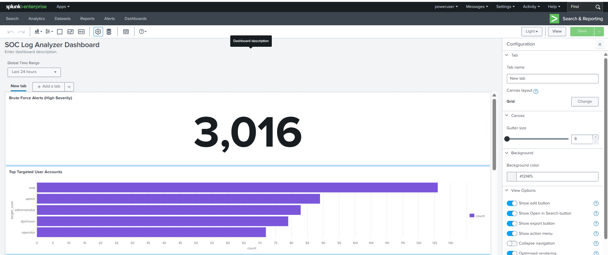
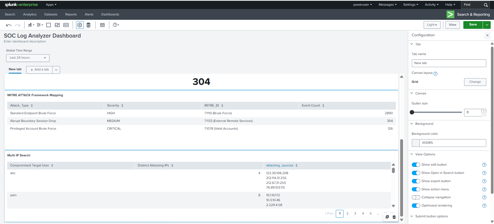

# Enterprise SIEM Security Analytics & Behavioral Detection Platform

An enterprise-grade Security Operations Center (SOC) dashboard built native to Splunk Dashboard Studio. The platform ingests, normalizes, and behaviorally analyzes multi-platform infrastructure logs—including Windows Active Directory (`winauthentication_security`), distributed Linux systems (`linux_secure`), and Cisco Perimeter Firewalls (`cisco_firewall`)—to expose complex threat indicators and map operational anomalies directly to the MITRE ATT&CK® framework.

## 🚀 Key Engineering Highlights
Unlike entry-level dashboard tools that pull static files, this platform implements active **SIEM Engineering** and **Detection Engineering**:
* **🛡️ High-Cardinality Behavioral Profiling:** Leverages advanced Splunk array functions (`mvindex`, `mvjoin`) and distinct count tracking (`dc(src_ip)`) to isolate distributed brute-force actions (e.g., 47 unique attacking sources targeting a single identity context) into a compressed, high-density threat hunting view.
* **🧱 Network Gateway Boundary Auditing:** Parses Cisco ASA Firewall connection states via targeted text string indexing to isolate unexpected perimeter disruptions (`Connection Lost`) and session eviction risks.
* **🗺️ Tactical Threat Attribution Matrix:** Interrogates multi-source event payloads programmatically via logical evaluation structures, automatically mapping vendor-specific telemetry to globally recognized adversary tactics (`T1110`, `T1133`, `T1078`).

---

## 🛡️ Detection Engineering Logic & Rules

The dashboard evaluates active network logs against these specific structural rule thresholds:

| Threat Vector | Telemetry Logic & Extraction Profile | Assigned Severity | Targeted MITRE ATT&CK ID |
| :--- | :--- | :--- | :--- |
| **Privileged Account Target** | Failed authentication attempts isolating administrative vectors (`root` / `Administrator`) | **CRITICAL** | `T1078` (Valid Accounts) |
| **Distributed Brute Force** | Distinct tracking (`dc(src_ip) > 1`) evaluating concurrent attack origins targeting a single user identity | **HIGH** | `T1110` (Brute Force) |
| **Boundary Session Drop** | Abrupt remote workforce VPN disconnection signatures indicating boundary instability | **MEDIUM** | `T1133` (External Remote Services) |

---

## 🖥️ Live Dashboard Overview

### 1. Global Metrics & Ingress Timelines
The main interface dashboard panels provide a real-time view of unified endpoint brute force alerts, perimeter VPN drops, and high-priority account targeting metrics.

*Insert your top metrics screenshot here:*

### 2. Behavioral Threat Hunting & Framework Mappings
Displays the multi-vector array hunting table showing compressed attacking IP lists right next to the active MITRE ATT&CK matrix mappings.

*Insert your bottom tables screenshot here:*

---

## 📦 Repository Structure
* `/src/dashboard_source.json` - Native Splunk Dashboard Studio source layout JSON definition code for seamless absolute layout environment replication.
* `/queries/SPL_Queries.md` - Complete performance-tuned catalog detailing the advanced data-coalescing and string-limiting queries used.
